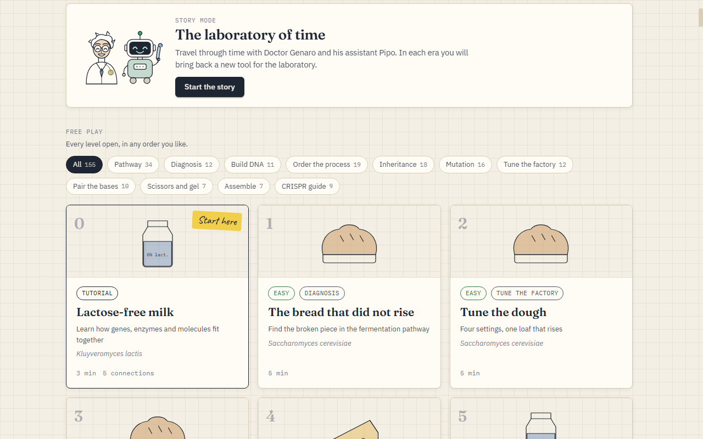
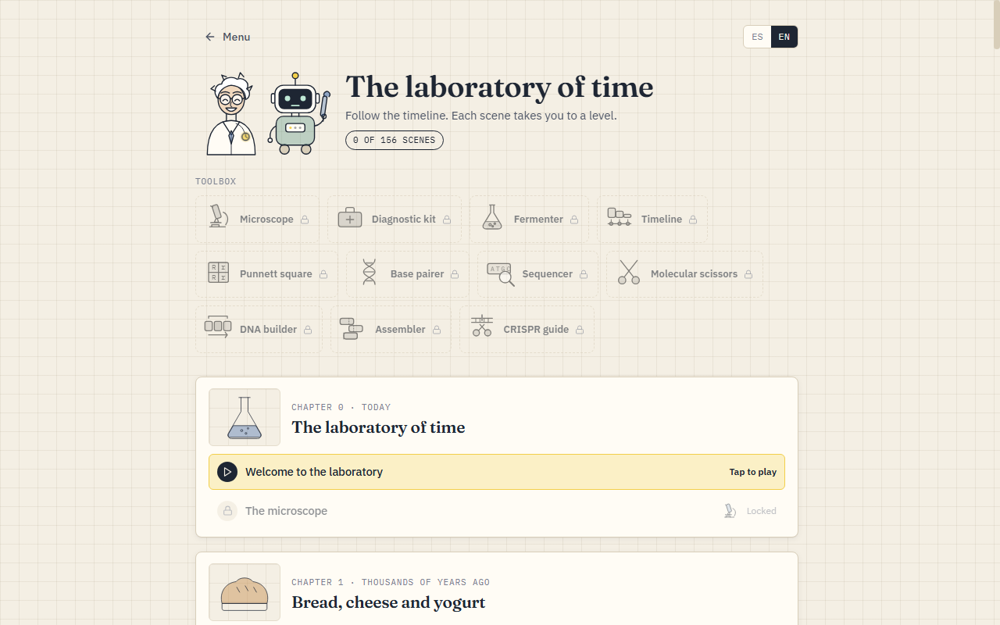
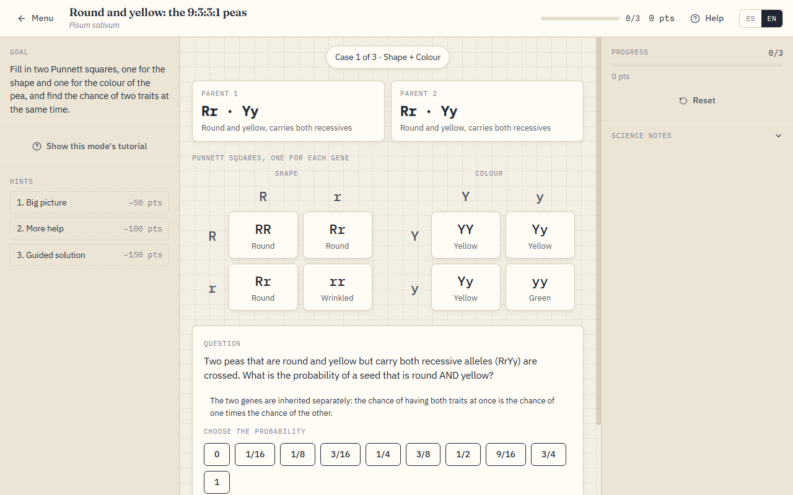
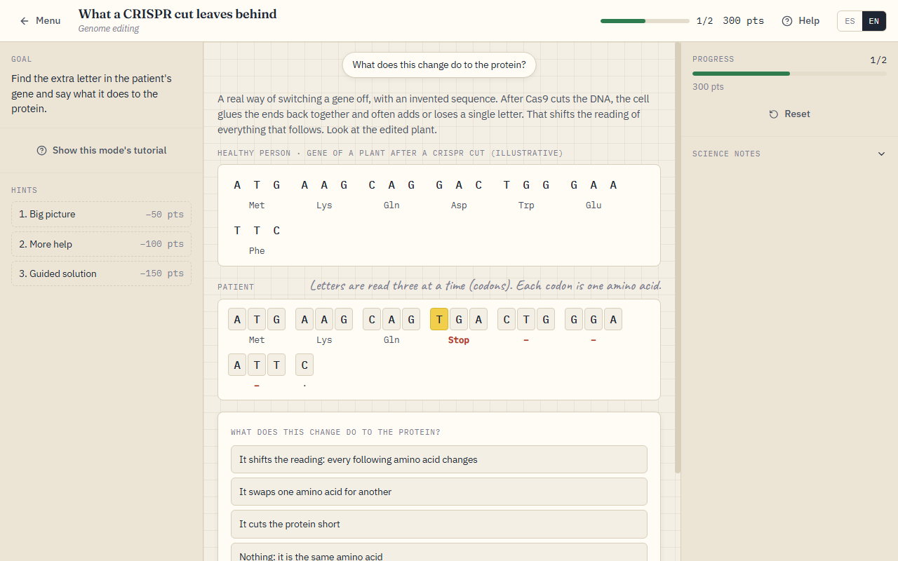
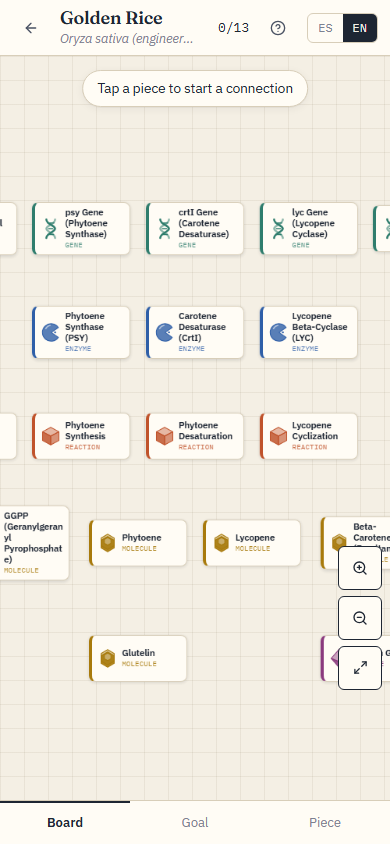

# Genlab

A bilingual (Spanish / English) educational game about biotechnology. You solve real cases by building, repairing and tuning biological systems, in a lab-notebook look.

**Play it online:** https://francisco-b-o.github.io/genlab/

Current version: **0.0.1 (beta)**.

| Free play and story | The story map |
|---|---|
|  |  |

| Two genes at once | An added letter shifts the reading | On a phone |
|---|---|---|
|  |  |  |

There are two ways to play:

- **Story mode** — Doctor Genaro, a time-travelling scientist, and his robot assistant Pipo take you through ten thousand years of biotechnology: 15 chapters and 156 scenes. Each way of playing is a *tool* of the laboratory that the story hands over at the right moment.
- **Free play** — every level open, filterable by way of playing.

## Quickstart

```bash
npm install
npm run dev        # http://localhost:5173
npm test           # unit tests, including a playthrough of every level
npm run build      # type check + production build
```

## The ways of playing

155 levels in 11 modes (a level is a JSON file in `src/data/levels/`):

| Mode | What you do |
|---|---|
| Pathway | Connect genes, enzymes and molecules into a biological pathway |
| Diagnose | Find the broken piece of a pathway and choose the treatment |
| Construct | Put DNA parts (promoter, RBS, gene, terminator…) in the right order |
| Sequence | Order the steps of a real process |
| Inherit | Fill in Punnett squares and work out probabilities, for one gene, a gene on the X chromosome or two genes at once |
| Mutation | Spot the changed, extra or missing letter in a gene and say what it does to the protein, including frameshifts |
| Tune | Choose settings within a budget to reach a target |
| Pairing | Complete a DNA strand, copy it into RNA, or read codons into amino acids |
| Cut | Choose restriction enzymes to cut a gene out of DNA, and read the gel |
| Assemble | Rebuild a sequence from overlapping fragments (shotgun sequencing) |
| CRISPR | Choose the guide that makes Cas9 cut only inside the gene |

Every mode has a guided tutorial that starts the first time it is played.

## Tech stack

TypeScript 5 (strict), Vite 5, React 18, Zustand, Framer Motion, vitest. Three.js is loaded lazily, only for the molecular viewer.

## Documentation

- `ARCHITECTURE.md` — the code: game state, modes, level format, story and how to extend each one.
- `docs/STATUS.md` — what exists today, how to extend it and the ideas that are next.
- `CONTRIBUTING.md` — branches, commits and checks before pushing.

## Adding content

- **A level**: write the JSON (see any file in `src/data/levels/` of the same mode and the types in `src/types/level.types.ts`) and register it in `LEVEL_REGISTRY` in `src/levels/LevelLoader.ts`. Every string needs a Spanish variant in a `<field>_es` key.
- **A scene of the story**: add it to a chapter in `src/story/chapters/`.
- The tests check the data of every mode, that both languages are complete, that no two cards overlap on the 2D board and that **every level can be solved** through the same store actions the boards call (`src/tests/playthrough.test.ts`).

## Scientific content

Each level has a science card that separates:

- **Real science**: facts and references.
- **Gameplay simplifications**: what was made simpler to be playable.
- **Invented examples**: the sequences and settings of some levels are made up to illustrate an idea, and say so.

## Branches and deployment

`main` holds the stable game, `develop` is where work is integrated and `gh-pages` holds only the built site. A push to `main` runs the tests, builds the game and publishes it on `gh-pages` (see `.github/workflows/deploy.yml`). In the repository settings, set Pages to serve the `gh-pages` branch.

## License

MIT, see `LICENSE`.
